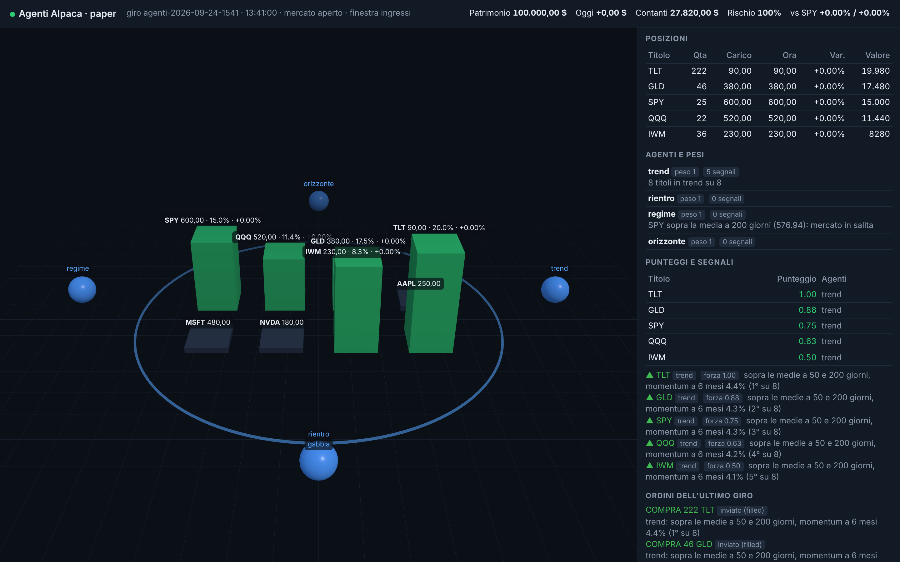

# Agente di paper trading Alpaca

Un solo modo di lavorare: il **motore degli agenti** (`bun run agents`), processo sempre acceso sul tuo PC (avvia-bot.cmd),
più agenti che osservano e votano, Kronos e il cervello delle previsioni, dashboard locale e pagina pubblica. Le sveglie
classiche (4 al giorno con `claude -p`, anche nel cloud) sono state tolte: la logica completa è in `docs/logica-del-motore.md`.

## Motore degli agenti

```sh
bun run agents                       # ogni 5 minuti: conto, agenti, gabbia, ordini, stop, diario; dashboard su http://127.0.0.1:8787
bun run agents --fake --once         # un giro con broker finto, senza dashboard
bun run agents --kronos http://127.0.0.1:8765   # aggiunge l'agente Kronos (sidecar in tools/kronos/server.py)
bun run dashboard                    # solo la dashboard, in lettura, sullo stato esistente
```

Opzioni: `--tick 5` (minuti tra un giro e l'altro), `--port 8787`, `--no-dashboard`, `--fake`, `--once`, `--no-crypto` (toglie le crypto, che nel motore sono di serie e lavorano 24 ore su 24 con la stessa logica dei titoli), `--no-kronos`, `--kronos url` (sidecar già acceso altrove), `--profitto`.
Da tenere acceso il PC (o un altro processo con lo stesso `state/`): il motore riparte da `state/` dopo un riavvio,
il lock e gli ID degli ordini (uno per giro) evitano doppioni.

| Agente | Cosa guarda | Segnali |
|---|---|---|
| `trend` | chiusura sopra le medie a 50 e 200 giorni, **rendimento a 12 mesi positivo** (momentum assoluto, altrimenti liquidità), classifica per momentum a 6 mesi; crypto anche a 3 mesi positivi | compra i migliori 5 (forza 1 → 0,5 per classifica); vende chi ha in mano sotto la 50 |
| `rientro` | mean reversion di Connors: RSI(2) sotto 10 con prezzo sopra la media a 200 | compra (0,7) con **taglia massima 5%**; esce (vincolante) a RSI(2) sopra 70 o dopo 5 sedute, solo per i trade aperti da lui solo |
| `regime` | SPY contro la sua media a 200 giorni e la volatilità a 20 giorni | nessun ordine: dimezza l'esposizione ammessa quando il mercato è debole o nervoso |
| `orizzonte` | trade aperti da **60 sedute** (un trimestre) | vende (0,8) solo se lo slancio è finito; se il trend regge tace |
| `contesto` | **prima di ogni trade**: situazione economica generale e per settore (regole sui dati: SPY e media a 200, volatilità, oro e obbligazioni in salita con SPY in calo, titoli del settore sotto la 50 — il settore crypto su tutto l'universo del giorno —, Fed nei prossimi 2 giorni; più, se c'è `claude -p`, una lettura con ricerca web ogni 6 ore in `state/macro.json`) | nessun ordine: esposizione × 0,75 (neutro) o × 0,5 (sfavorevole). **Il contesto corrente non decide da solo**: se Kronos anticipa un rialzo (≥ +1% a 5 sedute) il settore debole non ferma l'ingresso; se anticipa un ribasso (≤ −1%) si aspetta anche con contesto buono; eventi (Fed, trimestrali) bloccano comunque |
| `uscite` | ogni posizione: perdita dal carico, massimo visto, proiezione di Kronos se il contesto si fida | **vincolante** (non si vota). Di serie (`mode: "trend"`): stop **scalato sulla volatilità** (2,5 × vol × √5, tra 5% e 10%, anche come stop GTC su Alpaca), nessun obiettivo (l'uscita normale è il trend della gabbia), proiezione negativa: esce subito. Opzioni: `trailAtr` per uscire anche a N ATR dal massimo; `mode: "obiettivo"` per la vecchia politica a +3%/+4% con stop fisso -3% |
| `kronos` | previsioni del modello a 5 sedute (percorso giorno per giorno), calcolate una volta al giorno sulle barre giornaliere e salvate in `state/previsioni.json`; tenute solo il 25% più nette e nel verso del trend | compra/vende (0,5); le stesse proiezioni guidano `uscite` e disegnano gli scenari nella dashboard |
| `custodi` | **un investitore per ogni titolo o crypto in trend** (sopra le medie 50/200, slancio a 12 mesi positivo, crypto anche a 3 mesi) o in portafoglio; **senza numero fisso**: tanti quanti i titoli che meritano attenzione, zero se il mercato non offre niente. Ognuno dichiara tesi, piano e rischio e **studia un dossier** a ogni giro: Kronos (45%: probabilità di rialzo = rendimento atteso / volatilità), grafico (25%: struttura, rotture, rientro sulla media a 20, eccessi, RSI, compressione), notizie (15%: Google News ogni ora), contesto (15%) → **probabilità favorevole** e **prossima azione**; più la **memoria del titolo** dal diario (trade passati, vinti, stop, quale ingresso ha reso) | entra (0,6; 0,8 sul rientro verso la media a 20; 0,25 se oltre il 15% sopra la 50) con forza modulata da dossier e memoria (3 trade persi → metà taglia); Kronos ≤ −1% ferma l'ingresso, ≥ +1% lo rafforza; esce sotto la media a 50 (0,9) o con slancio a 3 mesi negativo (0,6) |
| `intraday` | **operazioni che si chiudono in giornata**: candela scelta dalla volatilità (≥ 3% → 5 min, ≥ 1,5% → 15 min, altrimenti 4 ore), solo nel verso del trend giornaliero e mai contro Kronos; ingresso su rottura dei massimi a 20 candele (movimento ≥ ½ ATR) o rientro sulla media a 20 candele; non si insegue oltre 3 ATR | compra (forza 1, peso ≤ 10%, max 3 aperte, un ingresso per titolo al giorno); **vincolante**: esce all'obiettivo (max tra 1%/2% e 1,5 ATR), allo stop (1,2 ATR), a due candele sotto la media a 20, e comunque entro le 21:45 (titoli) / 23:30 (crypto) |
| `profitto` | guadagno oltre +3% su un trade non ancora alleggerito | **vincolante**: vende metà e lascia correre il resto col trend (`AGENTS.takeProfit`: `fraction` 1 per vendere tutto, `enabled: false` per spegnerlo) |

L'**allocatore** somma i segnali pesati (peso 1 per tutti finché il diario non ha un campione; poi 0,5 a chi perde,
1,2 a chi vince con campione affidabile), compra sopra 0,5 e vende sotto -0,5; il peso obiettivo di un titolo è il massimo
della gabbia (20%, meno se volatile) × rischio del regime e del contesto, con il tetto del comparto (5% per il rientro);
poi la **volatilità di portafoglio**: se le posizioni volute supererebbero il 12% annuo (√252 × 0,8 × Σ peso × volatilità),
le taglie nuove scendono in proporzione. Poi tutto passa dalla **gabbia** (`src/cage.ts`):
acquisti solo nella finestra 15:40-17:30 di Roma e una sola volta al giorno per titolo, vendite e stop a mercato aperto.
Lo stop GTC su Alpaca è scalato sulla volatilità (5-10%); la politica di uscita si regola in `src/config.ts` (`AGENTS.exit`).
Gli agenti comprano solo in `AGENTS.universe` (SPY QQQ AAPL MSFT NVDA GLD: niente IWM e TLT, che con obiettivo +3% e
stop -3% hanno attesa nulla o negativa); una posizione vecchia resta sorvegliata e vendibile.

**Crypto** (di serie nel motore degli agenti, `--no-crypto` per toglierle): l'universo è **tutte le coppie USD negoziabili su
Alpaca che stanno nella top 100 per capitalizzazione** (CoinGecko, rinnovato una volta al giorno in `state/crypto-universe.json`; senza
CoinGecko restano le coppie di Alpaca; stablecoin e token ancorati esclusi; massimo 40 coppie, `AGENTS.cryptoUniverse`). La scelta di
cosa comprare resta del motore: trend, momentum, custodi, allocatore, gabbia. 24 ore su 24, anche a borsa chiusa e fuori finestra, un ingresso al giorno per coppia,
quantità frazionarie (6 decimali, minimo 10 $), stop su Alpaca come `stop_limit` (Alpaca non accetta lo `stop` a
mercato sulle crypto) con limite mezzo punto sotto. Le posizioni crypto di Alpaca (`BTCUSD`) sono normalizzate a `BTC/USD`.
L'interruttore a -5% dal massimo (spento di serie) si **riarma da solo dopo 5 giorni di borsa**.

Ogni cosa che succede finisce nel **registro eventi** `state/events/AAAA-MM-GG.jsonl` (prezzi, segnali, rischio,
allocazione, ordini, rifiuti, stop, trade, allarmi) e nello stato `state/agents-status.json`. La **dashboard**
(`src/dashboard/`) li legge e risponde in italiano semplice a quattro domande, in ordine: va tutto bene (frase di stato: motore acceso, Alpaca raggiungibile, borsa aperta/chiusa, crypto), quanto guadagno oggi (patrimonio, conto del giorno realizzato e non), cosa ho in mano (posizioni) e cosa hanno deciso gli agenti e perché (ordini, rifiuti raggruppati per motivo, punteggi, agenti). Sotto, apribile, il pavimento 3D dei mercati (altezza = peso in portafoglio, colore = guadagno/perdita), agenti in
orbita che lanciano i segnali verso i titoli, anello della gabbia, pannelli con posizioni, punteggi, ordini, rifiuti,
stop, diario ed eventi in diretta via WebSocket. Three.js è servito dal pacchetto npm: funziona senza internet.
Telegram riceve ogni ordine inviato, gli allarmi e un riepilogo dopo le 22:05 con il **conto di profitto e perdita della
giornata**: ogni vendita eseguita oggi con guadagno o perdita in dollari e in percentuale (carico → uscita, parziale o
chiusura, motivo), il totale realizzato, il conto per agente (chi aveva votato l'ingresso), gli acquisti del giorno e il non
realizzato sulle posizioni aperte. Lo stesso conto è nella dashboard ("Profitto e perdita di oggi") e in
`state/agents-status.json` (`pnlOggi`); il diario conserva ogni esecuzione con la sua data (`acquisti`, `vendite`).
Nel fine settimana il riepilogo parte solo se c'è stato movimento (crypto).



### Installazione su Windows

`installa-windows.ps1` crea il progetto in `D:\Applicazioni\WebDev\Bot alpaca agents` (o nella cartella passata come
argomento): controlla git e bun, clona il repo sul branch del motore, installa, crea `secrets.ts`, lancia i test e mette sul
desktop il collegamento "Bot alpaca agents" che avvia `bun run agents` (nella cartella c'è anche `avvia-bot.cmd`, stesso effetto con un doppio clic; `imposta-telegram.cmd` ricava e scrive il chat id). Da PowerShell:

```powershell
irm https://raw.githubusercontent.com/Nisiix/AlpacaTrader/ccr-f218832d-solbom/installa-windows.ps1 -OutFile installa-windows.ps1
powershell -ExecutionPolicy Bypass -File installa-windows.ps1
```

### Da dove vengono i parametri di base

I valori di serie della politica di uscita (stop sulla volatilità, presa di profitto parziale a +3%, nessun trailing) sono
stati scelti con backtest e walk-forward 2021-2026 sul motore di allora, prima di Kronos, dell'intraday e del cervello delle
previsioni: quegli strumenti (backtest, sweep) sono stati tolti perché non misuravano più il motore attuale. Oggi la
misura è il diario dei trade veri e il cervello delle previsioni, che confronta ogni previsione con il prezzo reale.

### Kronos, il sidecar Python

Kronos (modello open source per candele OHLCV, MIT) è parte del motore: `installa-kronos.cmd` (Windows) o `installa-kronos.sh`
scarica il codice del modello in `tools/kronos/kronos-src`, crea `tools/kronos/venv` e installa torch per CPU. Da lì in poi
`bun run agents` **accende il sidecar da solo** (`tools/kronos/server.py --model small --port 8765`), gli manda le barre che ha
già scaricato (niente chiavi Alpaca nel sidecar) e salva le proiezioni del giorno in `state/previsioni.json`. I pesi del modello
arrivano da Hugging Face al primo avvio (1-2 minuti); il motore intanto lavora senza proiezioni e lo dice nella dashboard.
`--kronos http://host:porta` usa un sidecar già acceso, `--no-kronos` lo esclude. Modello, porta e campioni in `AGENTS.kronos`.

### Dashboard: scheda per titolo

«Titolo per titolo»: i titoli in tre gruppi — **in portafoglio** (verde), **sotto osservazione** (custodi, voti d'acquisto, in
attesa del contesto; blu) e **nel radar** (grigio). Per il titolo scelto: le ultime 120 candele con medie 20/50/200, carico e stop del
motore, le operazioni fatte (▲▼ dal diario), la **candela di oggi che si forma in diretta** con i prezzi letti dal motore a ogni giro,
le **scelte di oggi** del motore sul titolo (puntini = voti, frecce = ordini, × = rifiuti) con il feed sotto il grafico, e lo
**scenario di Kronos**: il percorso previsto per le prossime sedute con il cono d'incertezza (una volatilità e mezza), ricaricato da
solo appena il motore calcola proiezioni nuove. Nessun ordine parte dalla dashboard. Dati: `/api/bars`, `/api/previsioni`, `/api/journal`.

### Impostazioni, schede degli agenti, guida

Nella dashboard le voci sono quattro: **Oggi** (soldi, profitto e perdita, posizioni, ultimo giro e il registro della
giornata), **Titoli** (grafico e verdetto per titolo), **Agenti** (Squadra: capo ufficio, custodi, voti; Ufficio 3D) e
**Impostazioni**, con tre schede: **Agenti** (ogni agente ha ruolo, come decide e i parametri regolabili; i valori salvati
stanno in `state/impostazioni-agenti.json` e valgono dal giro successivo, «Di serie» li toglie), **Chiavi e motore** (chiavi
Alpaca paper, Telegram e X con «Prova» — trova anche il chat id — e «Salva» in `secrets.ts`, mai rimandate in chiaro; il
motore le legge al riavvio) e **Guida**. I vecchi indirizzi (`#panoramica`, `#cronologia`, `#3d`, `#guida`) portano alla
nuova sistemazione. La finestra degli acquisti sui titoli è tutta la seduta (15:35–21:55 Roma); le crypto trattano sempre.
La logica completa è in `docs/logica-del-motore.md`.

### Limiti del giorno, interruttore, riavvio

Per scelta dell'utente il motore **non ha tetti di rischio sul conto**: il limite di volatilità annua e l'interruttore a −5% dal
massimo sono spenti (`AGENTS.volTarget.enabled`, `LIMITS.breakerEnabled`, riaccendibili dalle schede), nessun tetto alla perdita
del giorno, nessun numero fisso di titoli (`LIMITS.maxPositions` è solo una sicurezza a 100: il limite vero è la liquidità con il
**10% per titolo**, e la taglia scende con la fiducia nella proiezione di Kronos). Resta un **obiettivo del giorno con difesa del guadagno**:
toccato il **+10%** sul patrimonio di ieri gli agenti continuano a investire; se il guadagno del giorno torna al **+5%** vendono i
trade non favorevoli (Kronos non vede più rialzo) e tengono gli altri. Da **Impostazioni → Riavvia il motore** il processo esce con
codice 75 e `avvia-bot.cmd` lo rilancia da solo: codice e chiavi nuove entrano in uso senza toccare il PC.

### Ripartire da zero

`bun run chiudi-posizioni` (Windows: `chiudi-posizioni.cmd`) toglie gli stop e vende a mercato tutte le posizioni del conto paper
(a borsa chiusa l'ordine sui titoli si esegue all'apertura; le crypto subito), avvisa su Telegram, e al giro successivo gli agenti
ricominciano con i criteri di oggi. A ogni avvio il motore riparte da `state/` e dal conto Alpaca: niente da configurare, le
posizioni le decide giorno per giorno (universo crypto rinnovato ogni giorno, custodi che nascono e muoiono, trend ricalcolato a ogni giro).

Solo paper: l'endpoint `https://paper-api.alpaca.markets` è scritto nel codice e il motore si rifiuta di partire con uno diverso.

## Avvio

```sh
cp secrets.example.ts secrets.ts   # poi riempi i campi (chiavi paper PK..., token e chat id del bot)
bun run telegram-chat-id [--scrivi]   # dopo aver scritto /start al bot: stampa il chat id; con --scrivi lo mette in secrets.ts (su Windows: doppio clic su imposta-telegram.cmd)
bun run agents                     # il motore (su Windows: avvia-bot.cmd)
bun run breaker-reset              # riarma l'interruttore sulla perdita (dopo che hai guardato cosa è successo)
bun run chiudi-posizioni           # chiude tutte le posizioni paper per ripartire da zero (vedi «Ripartire da zero»)
bun test                           # test con broker finto
```

`--fake` usa broker finto (`state/fake/fake-broker.json`) e Telegram su file (`state/fake/telegram-outbox.log`).

## Regole della gabbia (`src/cage.ts`, numeri in `src/config.ts`)

- Universo: titoli e crypto degli agenti (più le scoperte dell'esplorazione). Niente short, niente leva, solo azioni intere
  (gli stop GTC di Alpaca non accettano frazioni); crypto in frazioni, ordine minimo 10 $.
- Massimo 10% del conto per titolo, e meno se il titolo è volatile: valore × volatilità giornaliera (20 giorni) ≤ 0,25% del conto.
- Massimo 35% del conto per **settore** (tecnologia, finanza, crypto…, anche per i titoli scoperti): si muovono insieme.
- Metodo: sopra la media a 50 **e** a 200 giorni, salvo un rialzo netto anticipato da Kronos; sotto la 200 solo contro
  tendenza (Kronos ≥ 2% con probabilità ≥ 60%), a metà taglia. Uscita di trend: chiusura sotto la media a 50, salvo
  Kronos che anticipa ancora un rialzo. Le operazioni intraday hanno le loro regole.
- Stop di protezione contro i crolli: 2,5 × volatilità giornaliera × √5, tra il 5% e il 10% dal carico; lo vende il codice
  a ogni giro **e** c'è uno stop GTC su Alpaca (crypto: stop_limit). Una vendita già in corso non si rimanda.
- Calendario: Fed scritta in `src/events.ts` (niente acquisti di azioni ed ETF nel giorno della decisione; le crypto no);
  trimestrali di tutti i titoli seguiti lette ogni giorno dal calendario pubblico di Nasdaq (`state/trimestrali.json`):
  niente acquisti del titolo nei 2 giorni di borsa prima dei conti.
- Registro degli errori (`state/lessons.json`): dopo uno stop loss niente riacquisto per 5 giorni di borsa; due rifiuti di
  Alpaca uguali bloccano quel titolo-lato per 5 giorni. Imparare dai risultati lo fanno capo ufficio e sala caffè.
- Interruttore (`state/breaker.json`): spento di serie, si riaccende dalle impostazioni come freno d'emergenza.
- Azioni solo a borsa aperta (orologio di Alpaca); crypto 24 ore su 24.

## File

| File | Responsabilità |
|---|---|
| `src/config.ts` | endpoint, universo, limiti, orari |
| `src/guard.ts` | rifiuta di partire con endpoint o chiavi live |
| `src/slots.ts` | ora di Roma e giorni di borsa |
| `src/broker/` | interfaccia, Alpaca REST v2, broker finto su file |
| `src/claude-runner.ts` | lancia `claude -p` per la lettura macro del contesto |
| `src/ordini.ts` | l'ordine proposto, prima della gabbia |
| `src/cage.ts` | regole: universo, 10% per titolo e volatilità, 35% per settore, medie 50/200 e contro tendenza, uscita di trend, stop, eventi, contanti |
| `src/indicators.ts` | media mobile, volatilità, momentum |
| `src/lessons.ts` | registro degli errori |
| `src/journal.ts` | diario dei trade: contesto, agenti e previsione all'ingresso, risultato all'uscita, conto di oggi e statistiche |
| `src/breaker.ts` | interruttore sulla perdita |
| `src/stops.ts` | distanza dello stop dalla volatilità, uno stop GTC su Alpaca per ogni posizione |
| `src/events.ts`, `src/earnings.ts` | calendario di Fed (a mano) e trimestrali (Nasdaq, ogni giorno), blocchi degli acquisti |
| `src/benchmark.ts` | confronto con SPY e con un 60/40 SPY/TLT comprati e tenuti |
| `src/execute.ts` | invio con ID deterministico, verifica dopo timeout, mai doppioni |
| `src/lock.ts` | un solo processo alla volta sullo stato, con le intenzioni d'ordine |
| `src/telegram.ts` | messaggi, allarmi ⚠️, riepilogo del giorno |
| `src/log.ts` | log in `logs/agenti-AAAA-MM-GG.log`, chiavi oscurate |
| `src/cli/` | `agents`, `dashboard`, `telegram-chat-id`, `breaker-reset`, `chiudi` |
| `src/agents/` | motore: `types`, `bus` (registro eventi), agenti `trend` `pullback` `regime` `horizon` `kronos`, `allocator`, `engine` (il giro) |
| `src/dashboard/` | server Bun (HTTP + WebSocket + Three.js locale) e pagina `index.html` |
| `tools/kronos/` | prova di Kronos sui dati Alpaca e sidecar `server.py` per l'agente |
| `docs/` | valutazione, risultati grezzi |
